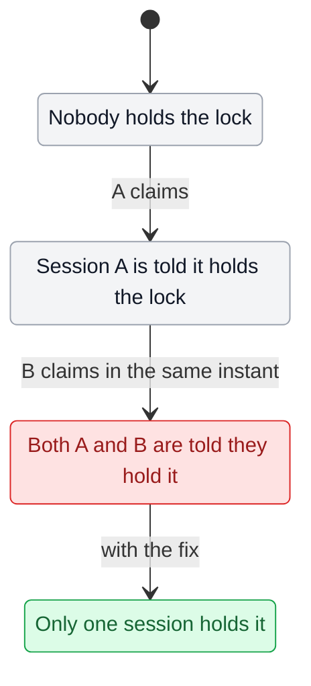

`Version 1.0.0 | Parent: statecraft 1.0.0 | Path: statecraft/reference | Filename: statechart.md | Created: 2026-10-21 03:36 ET`

# Drawing the statechart

The statechart is for a person first. It should read like the flow a user or an operator
lives through, not like code. Each box is a situation someone could describe ("The chat
gets a red unread count"), and each arrow is what happens next ("you open it on your
phone"). The model comes from the picture, and the picture gets the model's findings
painted back onto it.

## Contents
- Template
- Rules
- Marking findings
- Keeping it true

## Template

Mermaid `stateDiagram-v2` renders on GitHub, in most IDEs and in Markdown previews, so it
needs no tool to view. Keep the three classes and the key so every chart reads the same way.

## Rules

1. **Plain words.** A box names what someone sees or what is true, never a variable. An
   arrow names an action or an event in the words the user would say.
2. **Every branch.** Where the flow splits, draw a choice and every way out of it, including
   the boring one. The bugs tend to sit on the branch nobody drew.
3. **One chart per flow.** A second flow that shares a state gets its own chart that
   repeats that state. Do not grow one chart to cover everything.
4. **Mark what the code does today,** not what it should do. The fix arrives as a green
   box beside the red one, reached by an arrow labeled "with the fix".
5. **Under about 25 boxes.** Past that, split the flow, or the picture stops helping.

## Marking findings

- A law the checker broke: the state where it breaks turns `bug` (red). The arrows into it
  are the counterexample's steps, in the counterexample's order.
- A fix that the checker passed and a driver confirmed: a `fixed` (green) box beside it.
- A fix that only the model passed: still green, with "(model only)" in the label until a
  driver confirms it against the real code.
- Everything else stays `works` (gray). Gray means "not shown broken within the bound", not
  "proven".

## Keeping it true

The chart and the model sit together in the model folder (`statechart.md` beside the
`.tla`). Both name the commit their code citations were read at. When that code changes,
re-read the cited lines, redraw what moved, and run the checks again. A chart older than
its code is a souvenir, not evidence.
